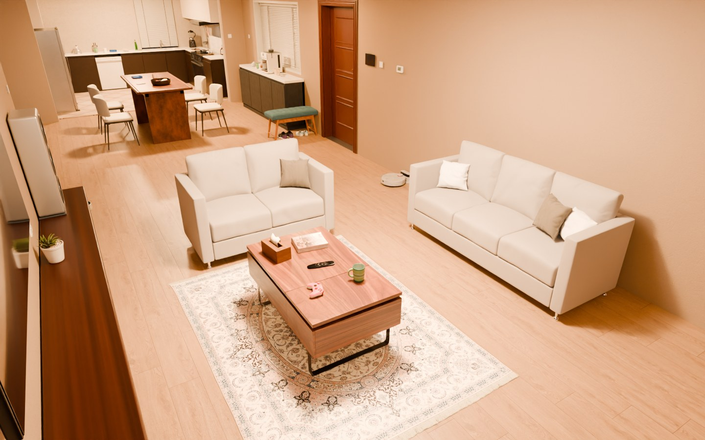
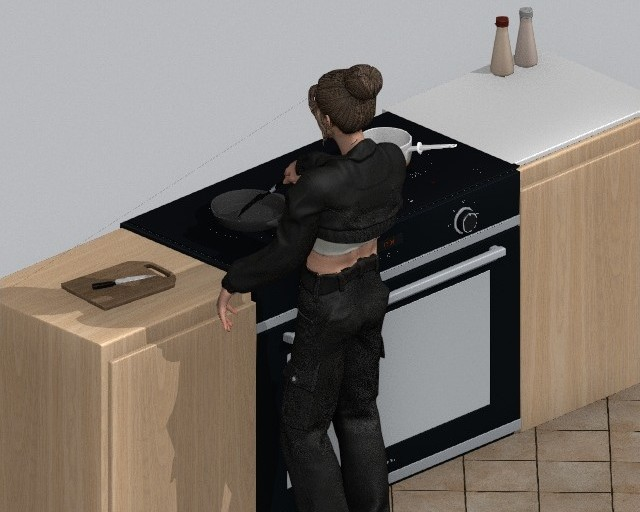
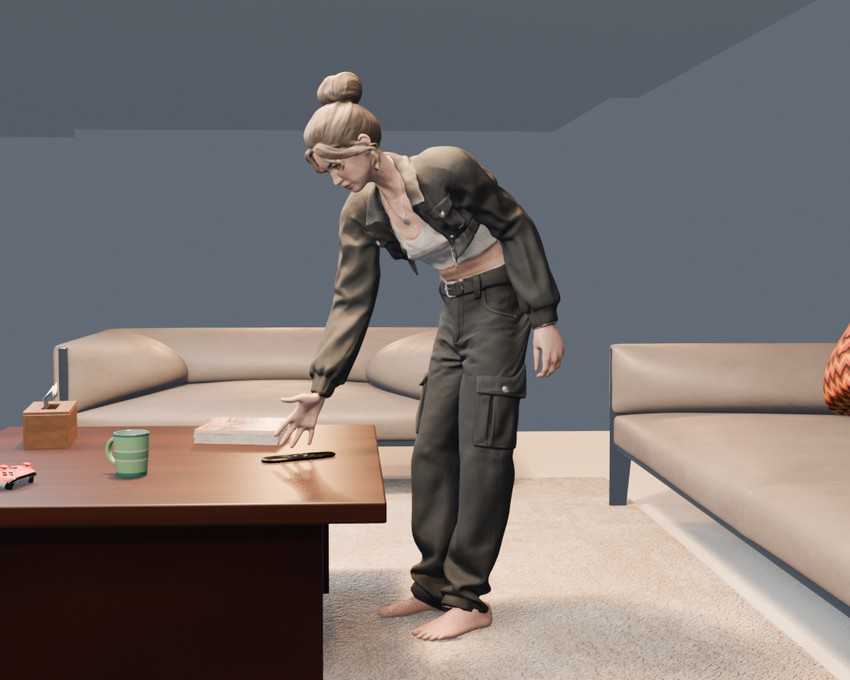
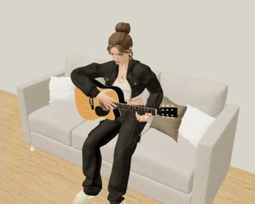
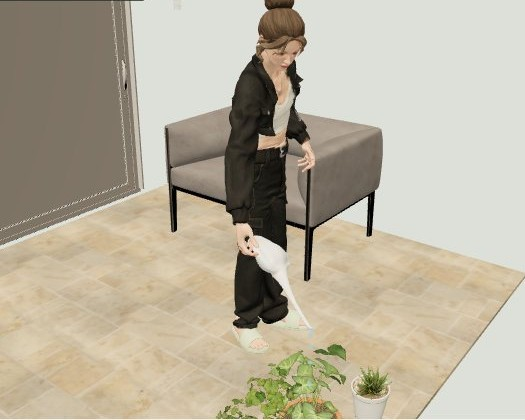

<h1 align="center">X-Family</h1>

A benchmark for understanding everyday routines in a smart home.

X-Family pairs a resident’s daily activities with the events recorded by devices around the home. Follow a day in 3D to see how the two unfold together.

[Explore the interactive 3D home](https://sylvvvvia2001.github.io/xfamily-house-demo/)

## X-Family at a glance

| Timeline per volunteer | Volunteer profiles | Registered motion branches | House asset groups |
|:---:|:---:|:---:|:---:|
| **1,680 hours** | **6** | **241** | **287** |

Each profile spans 70 days, for a total of **10,080 participant-hours**.

## Everyday activities

<table>
  <tr>
    <td width="50%" align="center">
       
      <em>Stirring food at the stove</em>
    </td>
    <td width="50%" align="center">
       
      <em>Reaching for the TV remote</em>
    </td>
  </tr>
  <tr>
    <td width="50%" align="center">
       
      <em>Playing guitar on the sofa</em>
    </td>
    <td width="50%" align="center">
       
      <em>Watering the balcony plants</em>
    </td>
  </tr>
</table>
